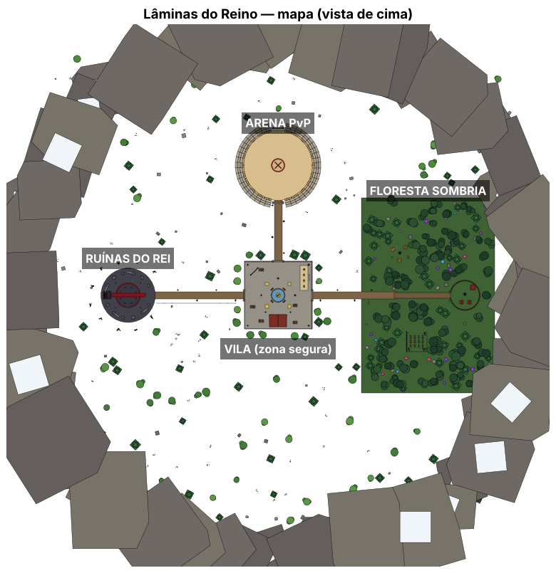

# ⚔️ Lâminas do Reino — jogo de espadas para Roblox

Jogo completo de espadas: mapa, modelos 3D, combate, inimigos, chefe, loja, níveis e salvamento.



## Como abrir e testar

1. Baixe o arquivo **`LaminasDoReino.rbxlx`**.
2. Abra no **Roblox Studio** (Arquivo > Abrir, ou arraste o arquivo para o Studio).
3. Clique em **Play** (F5).

Para salvar o progresso dos jogadores (moedas, nível, espadas):
publique o jogo e ative **Game Settings > Security > Enable Studio Access to API Services**.
Sem isso o jogo funciona normalmente, só não salva.

## Controles

| Tecla | Ação |
|---|---|
| Clique / Toque | Atacar (combo de 3 golpes — o 3º empurra) |
| F (segurar) | Bloquear (−75% de dano) |
| F na hora certa | **Parry**: atordoa quem te atacou |
| Q | Esquiva (fica invencível por um instante) |
| R | Habilidade especial da espada |
| B | Loja |
| H | Ajuda / controles |

No celular aparecem botões na tela. No controle: L2, B e Y.

## O que tem no jogo

- **Vila (zona segura):** fonte com espada gigante, Ferraria (loja), placar dos melhores, bonecos de treino.
- **Arena PvP (norte):** coliseu para lutar com outros jogadores e ganhar moedas.
- **Floresta Sombria (leste):** Goblins, Esqueletos e Orcs dão XP e moedas.
- **Ruínas do Rei (oeste):** chefe **Rei Caído** com golpe no chão, fase de fúria e guardas.
  Pode derrubar a espada lendária **Lâmina do Rei Caído** (30%).

### Espadas

| Espada | Preço | Nível | Efeito |
|---|---|---|---|
| Espada de Madeira | grátis | 1 | — |
| Espada de Ferro | 250 | 2 | — |
| Lâmina de Fogo | 900 | 5 | Queima |
| Presa de Gelo | 1.500 | 8 | Deixa lento |
| Katana Sombria | 2.500 | 12 | Rouba vida |
| Excalibur Celestial | 6.000 | 18 | Raio que pula entre inimigos |
| Lâmina do Rei Caído | drop do chefe | — | Atravessa bloqueio e executa |

Também tem: crítico, sequência de abates com recompensa pela cabeça, feed de abates,
níveis (vida aumenta a cada nível), ciclo de dia e noite e tochas que acendem à noite.

## Como mudar o jogo

Todos os números (dano, preços, vida dos monstros, XP...) ficam em um só lugar:
`ReplicatedStorage > Shared > Config` (no Studio) ou `src/shared/Config.luau`.

## Estrutura do projeto (para programadores)

```
src/shared/      Config e utilidades (ReplicatedStorage.Shared)
src/server/      Scripts do servidor (ServerScriptService)
src/client/      Interface, controles e efeitos (StarterPlayerScripts)
build/           Gera o mapa, os modelos e o arquivo .rbxlx
```

Para gerar o `.rbxlx` de novo após editar os arquivos, use o [Lune](https://github.com/lune-org/lune) 0.8:

```
lune run build/build.luau
```
