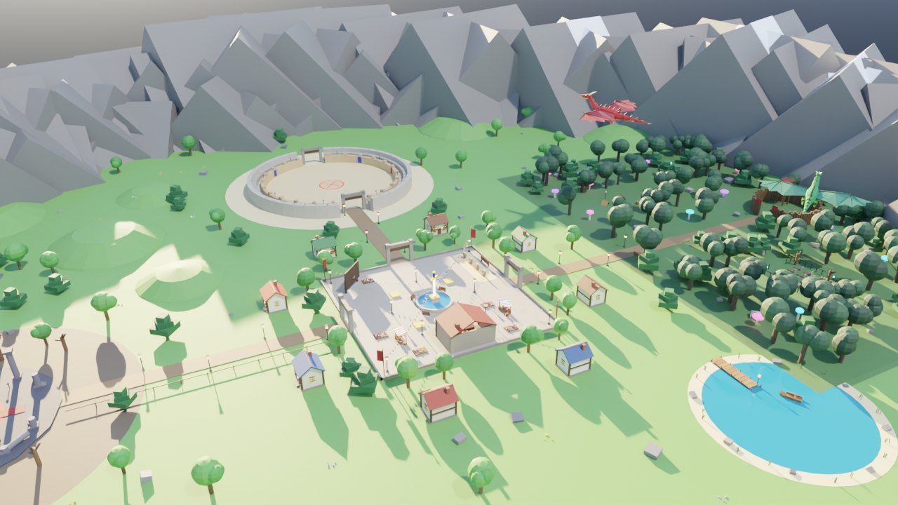
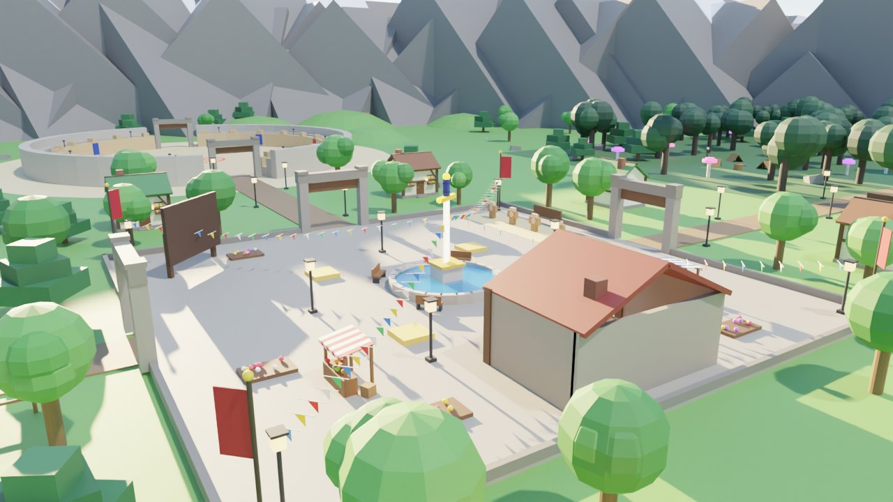
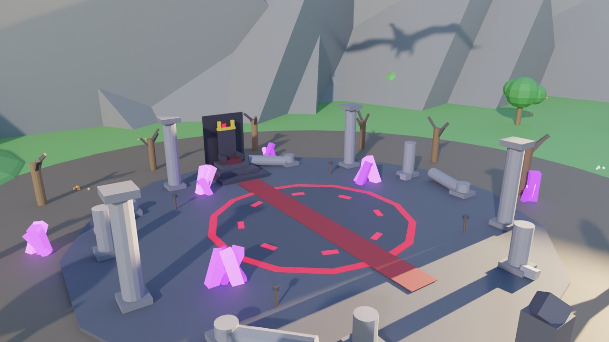
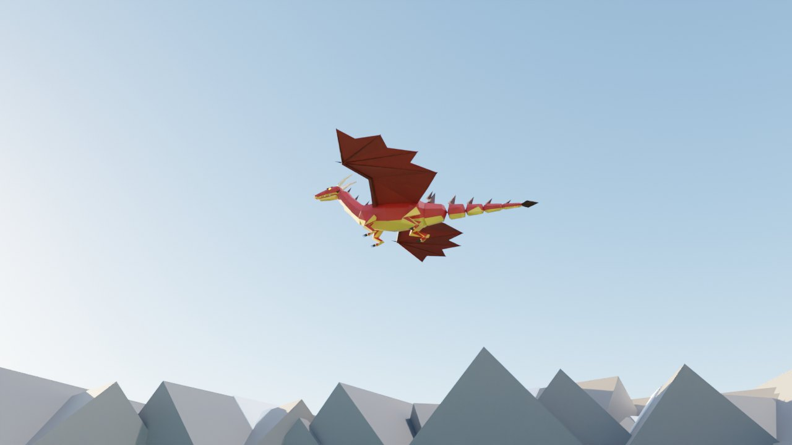

# ⚔️ Lâminas do Reino — jogo de espadas para Roblox

Jogo completo de espadas: mapa com terreno, dragões animados, combate, inimigos, chefe, loja, níveis e salvamento.



| Vila | Ruínas do Rei | Dragão no céu |
|---|---|---|
|  |  |  |

> As imagens são prévias renderizadas no Blender a partir das peças do jogo.
> No Roblox o terreno fica mais suave (grama animada, água com ondas, nuvens).

## Como abrir e testar

1. Baixe o arquivo **`LaminasDoReino.rbxl`**.
2. Abra no **Roblox Studio** (Arquivo > Abrir, ou arraste o arquivo para o Studio).
3. Clique em **Play** (F5).

- O **terreno** (morros, lago, montanhas com neve) é criado automaticamente quando o jogo começa.
  No modo de edição do Studio você vê só um chão verde provisório.
- Para salvar o progresso dos jogadores: publique o jogo e ative
  **Game Settings > Security > Enable Studio Access to API Services**.

## Controles

| Tecla | Ação |
|---|---|
| Clique / Toque | Atacar (combo de 3 golpes — o 3º empurra) |
| F (segurar) | Bloquear (−75% de dano) |
| F na hora certa | **Parry**: atordoa quem te atacou |
| Q | Esquiva (fica invencível por um instante) |
| R | Habilidade especial da espada |
| B | Loja |
| H | Ajuda / controles |

No celular aparecem botões na tela. No controle: L2, B e Y.

## O que tem no jogo

**Visual**
- Tela de carregamento, menu inicial com câmera de cinema passeando pelo mapa e pelos dragões.
- 3 dragões modelados no Blender (vermelho, verde e sombrio) voando com bater de asas, cauda e pescoço animados e sopro de fogo.
- Terreno com morros, lago com píer e barquinho, montanhas com neve, nuvens e grama animada.
- Vila com 8 casas (janelas acendem à noite), mercado, bandeirinhas, fonte com água e espada gigante.
- Ciclo de dia e noite com cores de amanhecer e pôr do sol, vagalumes na floresta, brasas e névoa nas ruínas, cristais brilhantes.
- Interface nova: cartão do jogador com foto, barras animadas, minimapa, loja com raridade e espada 3D girando,
  tela de subir de nível e tela de derrota.

**Jogo**
- **Vila (zona segura):** loja (Ferraria), placar dos melhores, bonecos de treino.
- **Arena PvP (norte):** lute com outros jogadores e ganhe moedas.
- **Floresta Sombria (leste):** Goblins, Esqueletos e Orcs dão XP e moedas.
- **Ruínas do Rei (oeste):** chefe **Rei Caído** com golpe no chão, fase de fúria e guardas.
  Pode derrubar a espada **Lâmina do Rei Caído** (30%).

### Espadas

| Espada | Raridade | Preço | Nível | Efeito |
|---|---|---|---|---|
| Espada de Madeira | Comum | grátis | 1 | — |
| Espada de Ferro | Comum | 250 | 2 | — |
| Lâmina de Fogo | Raro | 900 | 5 | Queima |
| Presa de Gelo | Raro | 1.500 | 8 | Deixa lento |
| Katana Sombria | Épico | 2.500 | 12 | Rouba vida |
| Excalibur Celestial | Lendário | 6.000 | 18 | Raio que pula entre inimigos |
| Lâmina do Rei Caído | Mítico | drop do chefe | — | Atravessa bloqueio e executa |

## Como mudar o jogo

Todos os números (dano, preços, vida dos monstros, XP...) ficam em um só lugar:
`ReplicatedStorage > Shared > Config` (no Studio) ou `src/shared/Config.luau`.

## Dragão no Blender

O modelo do dragão está em `build/assets/`:
- `dragon.blend` — abre no Blender para editar
- `dragon.fbx` — para usar em outros programas
- `dragon.json` — triângulos usados para montar o dragão no Roblox

Como o Roblox só aceita malhas enviadas para a conta do criador, o jogo transforma cada triângulo
do modelo em peças do Roblox. Assim o dragão funciona direto no arquivo, sem precisar enviar nada.

## Estrutura do projeto (para programadores)

```
src/shared/      Config e utilidades (ReplicatedStorage.Shared)
src/server/      Scripts do servidor (ServerScriptService)
src/client/      Interface, controles, efeitos, dragões e menu (StarterPlayerScripts / ReplicatedFirst)
build/           Gera o mapa, os modelos e o arquivo .rbxl
build/blender/   Scripts do Blender (dragão e prévias)
```

Para gerar o arquivo de novo após editar:

```
python build/blender/dragon.py build/assets     # opcional: refaz o dragão (precisa do Blender / pip install bpy)
lune run build/build.luau                       # gera LaminasDoReino.rbxl (Lune 0.8)
```
